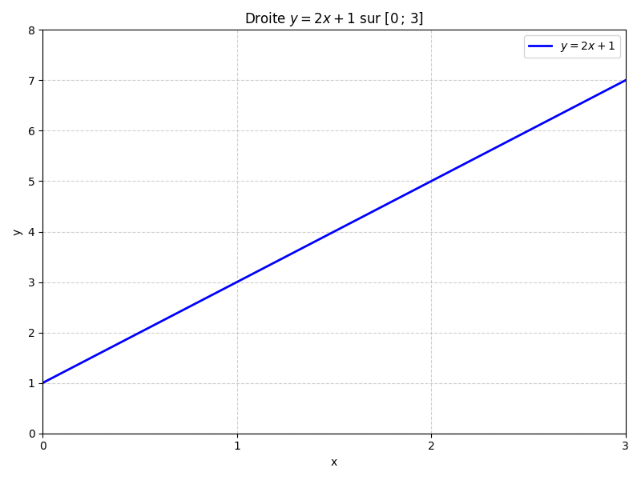

# Atelier Scientifique Physique : Tracé de la concentration en fonction de la masse volumique #

## Objectif ##

* Réaliser le tracé de la **concentration en masse ($t$) en fonction de la masse volumique ($\rho$)** à l'aide des données expérimentales.
* Modéliser la relation entre ces deux grandeurs.

## Matériel nécessaire ##

* Un ordinateur avec le logiciel **Atelier Scientifique Physique**.
* Un tableau de données comportant les valeurs de concentration en masse ($t$, en g/L) et les valeurs de masse volumique ($\rho$, en g/L).

## Étapes à suivre ##

1.  **Saisie des données dans le tableur**
    * Lancez le logiciel — Choisir "Généraliste" puis valider avec OK — Continuer sans interface — Fermer l'astuce du jour.
    * Rendez-vous dans l'onglet **"Tableau"**.
    * **Double-cliquez sur l'en-tête de la colonne A**. Dans la fenêtre "Grandeurs", nommez la grandeur **"t"** et entrez son unité **"g/L"**. Validez. Le logiciel demande ensuite le nombre de points à saisir dans le tableur. Dix points seront suffisants.
    * **Double-cliquez sur l'en-tête de la colonne B**. Nommez la grandeur **"rho"** et entrez son unité **"g/L"**. Validez.
    * Saisissez toutes vos valeurs de concentration dans la colonne A et les valeurs de masse volumique dans la colonne B.

2.  **Création du graphique**
    * Allez dans l'onglet **"Graphique"**.
    * Un menu déroulant se trouve à côté de l'**axe des abscisses (X)**.
    * Cliquez sur ce menu et choisissez la grandeur **"Masse volumique"**.
    * Le logiciel placera alors automatiquement la grandeur **"t"** sur l'**axe des ordonnées (Y)**. Il faut cliquer sur **"t"** pour faire apparaître les points. 

3.  **Modélisation de la courbe**
    * Vous pouvez modéliser la courbe pour trouver son équation.
    * Rendez-vous dans le menu **"Affichage"** et sélectionnez **"Modélisation"**.
    * Choisissez le modèle de courbe le plus approprié (souvent une droite).
    * Le logiciel tracera la courbe de tendance et affichera l'équation correspondante.

## Équation de droite ##

* Le tracé **"de $Y$ en fonction de $X$"** signifie que $Y$ est sur l'axe des ordonnées (vertical) et $X$ est sur l'axe des abscisses (horizontal). L'équation d'une droite est alors de la forme $y=ax+b$. Où $a$ et $b$ sont deux constantes qui permettent de définir la droite et de la tracer.

Exemple pour la droite d'équation $y=2x+1$:

{: .center width="50%"}

* Dans ce TP, la **concentration ($t$)** est sur l'axe Y et la **masse volumique ($\rho$)** sur l'axe X. Dans ce TP l'équation de droite sera donc de la forme $t=a\rho+b$. La modélisation va fournir la valeur de $a$ et celle de $b$.

